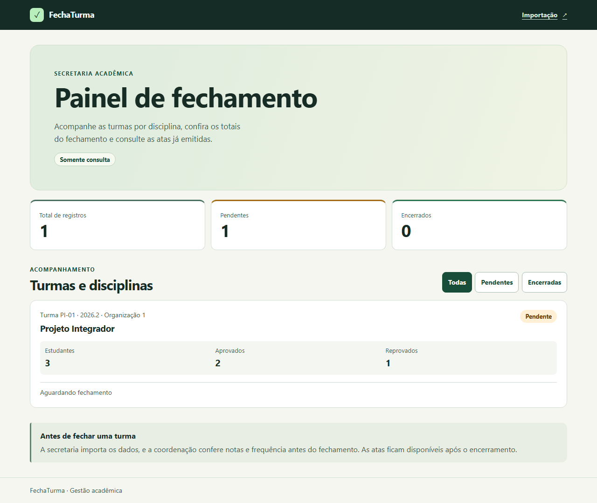

# FechaTurma

**Conferência de notas e frequência, da importação à emissão da ata.** Uma secretaria acadêmica pode descobrir pendências antes de enviar a turma à coordenação. O fechamento registra o retrato analisado e quem confirmou a decisão, sem escrever no sistema de origem.



*Captura da [demonstração automatizada no Windows](https://github.com/Thiago-jss/fechaturma/actions/runs/45690677016), após a importação e antes do fechamento.*

## Experimente

| Etapa | O que fazer | Resultado esperado |
| --- | --- | --- |
| Encontrar a pendência | Em **Importar uma turma**, informe período `2026.2` e turma `PI-02`. | A prévia aponta a matrícula sem nota e bloqueia a importação. |
| Registrar um retrato | Troque para `PI-01`, confira a prévia e confirme com a chave da secretaria. | São 3 matrículas: 2 aprovadas e 1 reprovada por frequência. Reenviar o mesmo retrato não duplica o registro. |
| Fechar | No aplicativo Windows, atualize a lista, selecione `PI-01` e confirme com a chave da coordenação. | A turma muda da versão 1 para a 2. Uma confirmação concorrente perde por conflito. |
| Consultar a ata | Atualize o painel e selecione o link da turma fechada. | A ata exibe as notas, a frequência e os dois eventos de auditoria. |

As regras deste laboratório são **nota ≥ 6,00** e **frequência ≥ 75%**. Uma reprovação válida não impede o fechamento; dado ausente ou inválido impede.

## Executar no Windows

Pré-requisitos: Windows x64, .NET Framework 4.8, IIS Express x64, SQL Server Express LocalDB, Node.js 22 e o SDK informado em `global.json`. Se usar Visual Studio 2022, instale as cargas *Desenvolvimento para desktop com .NET* e *Desenvolvimento para ASP.NET e Web*, com SQL Server Express LocalDB.

Em **Windows PowerShell**, na raiz do repositório:

```powershell
.\scripts\build-windows.ps1
$env:FT_IMPORT_KEY = [guid]::NewGuid().ToString('N')
$env:FT_DESKTOP_KEY = [guid]::NewGuid().ToString('N')
Start-Process .\src\FechaTurma.Desktop\bin\Release\net48\FechaTurma.Desktop.exe
Set-Clipboard -Value $env:FT_IMPORT_KEY
.\scripts\start-demo.ps1
```

Abra **http://localhost:5184**. A chave da secretaria foi copiada para a área de transferência. O desktop já abriu com a chave da coordenação mascarada; use **Atualizar lista** depois de importar a primeira turma. Use chaves descartáveis e limpe a área de transferência ao terminar.

O modo padrão usa notas fictícias em memória como origem e **SQL Server Express LocalDB real** como destino. Para conectar uma origem Oracle aprovisionada, defina `FT_ORACLE_CONNECTION` e execute `start-demo.ps1 -Source oracle`; para apontar também o destino a uma instância externa já migrada, defina `FT_SQL_CONNECTION` e acrescente `-UseExistingDatabase`. A aplicação não cai silenciosamente na fixture se o Oracle falhar.

## Como as peças se encaixam

- **C# 7.3 / .NET Framework 4.8:** domínio, WinForms, Web Forms, ASP.NET MVC 5 e Web API 2. A regra acadêmica é centralizada e os clientes não disputam a responsabilidade pela gravação.
- **SQL Server:** retrato e trilha de auditoria, transação, controle de concorrência e consultas parametrizadas.
- **Oracle:** projeção acadêmica fictícia consultada por uma conta de somente leitura. A origem e o banco de fechamentos têm responsabilidades distintas.
- **Angular e TypeScript:** painel de consulta. **HTML, CSS, JavaScript e jQuery:** prévia e filtro progressivo no Web Forms. Nenhuma biblioteca é carregada de CDN.

Leia [arquitetura e limites](docs/arquitetura.md), [API](docs/api.md), [cenários de aceitação](docs/fechamento.feature) e [operação e testes](docs/operacao.md) e [contrato de integração opcional](docs/integracao-rm.md). O projeto é um laboratório local com dados fictícios, não um ERP completo nem um serviço para publicar na internet.
