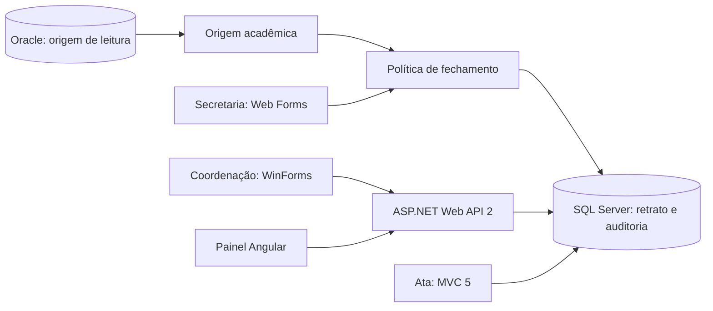

# Decisões de arquitetura

## Um fluxo de fechamento, não quatro implementações

A secretaria atua em Web Forms: consulta o retrato, enxerga pendências e só confirma um retrato completo. A coordenação usa WinForms e a API REST; não tem acesso direto aos bancos. O painel Angular lista fechamentos, e o MVC renderiza a ata somente após a confirmação. O domínio calcula resultado e bloqueios uma vez, independente da interface.

### Vocabulário

- **Turma:** disciplina em um período e uma coligada. O laboratório usa o código da turma como identificador dentro desse recorte.
- **Retrato:** conjunto ordenado das matrículas e resultados, calculado sobre o que foi lido da origem. Um hash identifica exatamente a versão visualizada.
- **Pendência:** falta de dado essencial, duplicidade ou valor inválido; impede a importação de toda a turma. Nota/frequência abaixo dos mínimos válidos significa reprovação, não pendência.
- **Ata:** representação do retrato após confirmação. Fechamento é terminal neste recorte; correção/reabertura requer um processo ainda não oferecido.

### Consistência

1. A prévia não grava. A importação relê a origem e compara o hash informado com o conteúdo observado. Isso protege contra confirmação de prévia obsoleta, mas não promete transação distribuída entre Oracle e SQL Server: o ponto de corte é a leitura que foi confirmada.
2. A chave `(Organization, Term, ClassCode)`, a transação serializável e o lock de atualização no índice garantem um retrato por turma. Uma repetição idêntica devolve o mesmo ID; um conteúdo diferente conflita.
3. O fechamento usa `UPDATE` condicionado a coligada, ID, versão e estado pendente. A decisão e o registro de auditoria são confirmados na mesma transação. Uma falha no evento desfaz a transição inteira. Consultas de detalhe usam uma transação para não combinar versão e eventos de momentos diferentes.
4. Se os clientes receberem 409, devem reler o detalhe em vez de repetir o comando com outra versão. A ata não é modificada em reenvios.

### Fronteiras do laboratório

- Somente dados fictícios e loopback; o host rejeita nomes externos. Leituras de demonstração não pedem login. Não exponha o site ou os bancos na rede.
- Chaves distintas para secretaria e coordenação; nunca são armazenadas no navegador, no código ou na auditoria. As operações exigem a função certa **no servidor**. O browser não usa credenciais ambientes (cookies ou autenticação automática) e exige a chave para a submissão; a API só lê Bearer explícito. Não há CORS habilitado.
- O servidor fixa a coligada da demo, e as consultas persistidas são escopadas por coligada. O laboratório não é um produto multi-tenant nem um sistema de identidade corporativa.
- O usuário Oracle recebe apenas `SELECT` na projeção. No Compose, o usuário de runtime SQL Server recebe acesso às operações de negócio, sem DDL nem `UPDATE`/`DELETE` na auditoria. A inicialização local via LocalDB usa a conta Windows do operador para simplificar o laboratório.
- Não há sincronização de volta para o ERP, PII real, anonimização de dados de terceiros, deploy ou exposição pública. Em produção seriam necessários TLS, identidade por pessoa, atribuição de coligadas e políticas de acesso e retenção antes de dados reais.

### O que cada execução prova

A suíte de domínio roda no SDK .NET 8 usando o mesmo código C# 7.3 também compilado para `net48`. Os testes de banco no Linux usam SQL Server 2022 e Oracle XE 21c reais para provar permissões e concorrência. O teste de navegador usa IIS Express e .NET Framework no Windows, SQL Server Express LocalDB e origem fixture explicitamente selecionada. Uma execução não substitui a outra.
